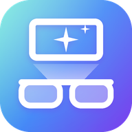

<div align="center">

 

# Beam Home and Station Home

> Two builds of [Free My TV](https://github.com/simbasjungles/free-my-tv) from one tree: **Beam Home** for the XGIMI Play 6 projector (China ROM) and **Station Home** for the Rokid Station (the box for Rokid's AR glasses). The package (`io.freemytv`), the log tag (`FreeMyTV`) and the signing key are the same as Free My TV's, so either one updates over it.

**A fast, ad-free home screen for the XGIMI Play 6 projector (China ROM) and the Rokid Station.**

Trending picks from your own apps, the weather at a glance, and a look that follows the sunset.<br>
Open source. Built with Claude Code. One button to undo.

</div>

## What you get

- **No ads.** No sponsored rows, banners or autoplaying promos. Not one.
- **Your apps, front and center.** The streaming apps you actually use, on a glass shelf. Pick them and their order right on the TV.
- **Trending, not sponsored.** Three fresh picks every hour from what's trending this week and the latest releases, only from apps you already have. Movies and Shows get their own tabs.
- **Weather and markets, one press away.** The hour-by-hour forecast, sunrise and sunset, and live crypto prices (off until you turn them on).
- **Light by day, dark by night.** It follows your city's real sunset, the way your phone does.
- **A screensaver to match.** Full-screen photos of the picks with a big glass clock.
- **Fast.** Drawn by hand on one Canvas, made for 60 fps on the device's own chip.
- **Set up on the TV.** Language, your city, temperature, theme, the weather and prices cards, which coins, and the apps on the shelf, in Free My TV's own settings.
- **Safe.** No root. Nothing is uninstalled. One button brings back the factory home screen.

## Install

About ten minutes. You need the XGIMI Play 6 or the Rokid Station and a computer on the same Wi-Fi. (On any other Google TV or Android TV, Android 9 or newer, either build runs as plain Free My TV.)

### The easy way: an AI assistant

1. **On the device**, write down its IP address. Both already have network ADB on port 5555 (the XGIMI takes any computer without asking; the Station asks once). On another TV, turn on developer mode first: Settings → System → About → press *Android TV OS build* 7 times, then Settings → System → Developer options → turn on **USB debugging**.
2. **On your computer**, open an AI coding assistant ([Claude Code](https://claude.com/claude-code), Codex or Antigravity) and say:
   > Install Free My TV (github.com/simbasjungles/free-my-tv) on my TV at 192.168.1.50. I live in Lisbon.

   It downloads the code, installs the tools it needs, builds the app and puts it on your TV, and asks before anything important. Swap in your TV's IP and your city.
3. **On the TV**, open *Free My TV* → *Home Screen* → *Free My TV*, and accept the debugging prompt (tick *Always allow*).

### The manual way

1. **On the TV**, do step 1 above.
2. **Tools:** a JDK (17+), the Android SDK command-line tools (build-tools 34, platform android-34) and adb. On a Mac:
   ```bash
   brew install --cask temurin android-commandlinetools android-platform-tools
   sdkmanager "build-tools;34.0.0" "platforms;android-34"
   ```
   On Linux, get OpenJDK 17, Android's command-line tools and adb from your package manager, then run the same `sdkmanager` line. On Windows, use Git Bash (which Claude Code uses there) or WSL.
3. **Build:**
   ```bash
   ./build.sh                  # Beam Home, for the XGIMI: BeamHome.apk
   DEVICE=rokid ./build.sh     # Station Home, for the Rokid Station: StationHome.apk
   ```
   The first run creates `config.properties`. Set your city and your [TMDB key](#the-tmdb-key) there, then run it again. `device=rokid` there builds Station Home without `DEVICE=`.
4. **Install:**
   ```bash
   adb connect 192.168.1.50:5555
   adb install -r BeamHome.apk     # or StationHome.apk
   ```
5. **On the TV**, open *Free My TV* → *Home Screen* → *Free My TV*.

## Two devices, one tree

`device=` picks what `build.sh` makes:

| `device` | App | APK | Made for |
|---|---|---|---|
| `xgimi` | Beam Home | `BeamHome.apk` | XGIMI projectors (Play 6, China ROM): Wi-Fi, Bluetooth, Picture and Time Zone screens in English; focus, keystone, speaker and eco mode in the drawer; the Play 6's battery on the home screen |
| `rokid` | Station Home | `StationHome.apk` | The Rokid Station: a Glasses page (2D/3D, refresh rate, picture, speakers, brightness, zoom) and a 2D/3D button; Wi-Fi, Bluetooth and Power screens; a sleep timer; the battery on the home screen |

Each device's parts run only in its own build and on its own device; on any other TV either build is plain Free My TV. Each one's name, icon, banner, settings mark and backgrounds live in `app/devices/<device>/`, drawn by `python3 tools/make_art.py <device>` and `python3 tools/make_backgrounds.py <device>`.

## Settings

The first values come from `config.properties`, created by the first build. Most of them can also be changed on the TV, in *Free My TV* → *Home Settings*, and the TV's choice wins:

| Key | What it does | Default |
|---|---|---|
| `device` | `xgimi` (Beam Home) or `rokid` (Station Home); `DEVICE=` when you build wins | `xgimi` |
| `tmdb_key` | Your free TMDB key, for the picks | empty |
| `tmdb_region` | Your country (two letters): which titles are on which app | `US` |
| `watchmode_key` | Optional, free [Watchmode](https://api.watchmode.com/) key: a pick opens the title's page in its app | empty |
| `latitude`, `longitude` | Your city, for the weather and the sunset | New York |
| `city` | The name on the weather card | `Weather` |
| `hide_animation` | Leave cartoons and anime out of the picks | `false` |
| `language` | `auto` (follows the TV), `en`, `es`, `pt`, `ru` or `de` | `auto` |
| `show_crypto` | Show Binance crypto prices on home and screensaver | `false` |
| `currency` | Crypto prices in `USD`, `EUR`, `BRL`… | `USD` |
| `temperature` | `C`, `F` or `auto` | `auto` |
| `disable_assistant` | Also turn off Google Assistant | `false` |
| `disable_telemetry` | XGIMI projectors: also turn off XGIMI's reporting apps | `false` |

Changed something? Run `./build.sh` and install again. Keep `freemytv.keystore`: updates are signed with it.

### The TMDB key

Free, and it takes two minutes: create an account at [themoviedb.org](https://www.themoviedb.org/signup), then open [Settings → API](https://www.themoviedb.org/settings/api) and request a developer key. Paste the *API Read Access Token* (or the *API Key*) after `tmdb_key=`. It's your key: `config.properties` stays out of git.

### Opening a title, not just its app (optional)

With a free [Watchmode](https://api.watchmode.com/) key (`watchmode_key=` in `config.properties`), a pick opens its own page in the streaming app instead of the app's home. The free plan (2,500 credits a month) is enough: each title costs two requests the first time and is remembered after that. It works where the app takes the title's web address (tested: Prime Video and JioHotstar); where it doesn't, the pick just opens the app, as without a key.

## Going back

On the TV: *Free My TV* → *Home Screen* → *Original*. The factory home screen, screensaver and every app come back exactly as they were. If the new home screen ever crashes three times in five minutes, it switches back by itself.

To remove it for good, switch to *Original* first, then uninstall *Free My TV* (Settings → Apps). Uninstalled it while it was on? Install it again and pick *Original*: the list of what it turned off is kept in the TV's settings, so everything comes back.

## What it changes

- It becomes the home screen and the screensaver.
- It turns off, without uninstalling:
  - on XGIMI projectors, XGIMI Home (XGIMI's chooser opens it whenever it is on), and XGIMI's reporting, ads, factory test and app market apps only with `disable_telemetry=true`;
  - on the Rokid Station, nothing: its system won't let apps be turned off, so it only takes the home screen;
  - on any other TV, the stock home screen and screensaver, Google TV's recovery home, Play Games and YouTube Music, and Google Assistant only with `disable_assistant=true`.
- Google services, the Play Store, the system UI and the Rokid Station's own apps are on a protected list, checked before every change, and an app that runs a TV input (HDMI, a tuner) is never turned off.
- Apps that saved a Wi-Fi network are never turned off, since Android would erase the network. If the TV's first setup saved yours, the switch asks you to forget the network and connect again in Settings first (saved networks out of range don't show there; Claude Code can remove them).

## Make it yours

It's your code, and Claude Code finds its way around it. Try:

- *"Add Crunchyroll to the shelf."*
- *"Show the prices in euros."*
- *"Add Spanish."*
- *"Switch to the night look an hour after sunset."*

## How it works

- **A plain Android app, no Gradle.** [`build.sh`](build.sh) runs aapt2 → kotlinc → javac → R8 → zipalign → apksigner and makes a 1.5 MB APK. The code is moving from Java to Kotlin (2.4.20, from JetBrains' release in `~/.local/share/kotlin/2.4.20`); the Kotlin standard library is the one library, and R8 keeps only what the app uses.
- **It uses the TV's own ADB, from inside the TV.** The app connects to `127.0.0.1:5555` with its own key (that's the *Allow USB debugging?* prompt) and runs the same commands you would: `cmd package set-home-activity`, `settings put secure screensaver_components`, `pm disable-user`. Nothing listens to the network.
- **Drawn by hand on one Canvas**, with Android 13 shaders for the frosted glass and the sky (plain fills on Android 9 to 12, with lighter shadows and no GPU layers on 9 to 11 for their older GPUs).
- **A safety net.** A watchdog in a separate process brings back the stock home screen after three crashes in five minutes, and a boot check keeps your choice after TV updates.
- **Data** from TMDB (trending titles, new releases and which app streams what in your country), Open-Meteo (forecast, sunrise and sunset), and optionally Binance (24-hour prices, only while the prices are on: `show_crypto=true` or *Home Settings*).

| File | What it is |
|---|---|
| [`HomeView.java`](app/src/io/freemytv/HomeView.java) | The home screen |
| [`HomeMode.java`](app/src/io/freemytv/HomeMode.java) | Switching between Free My TV and Original |
| [`Adb.java`](app/src/io/freemytv/Adb.java) | The TV's own ADB, from inside the TV |
| [`Recs.java`](app/src/io/freemytv/Recs.java) | The picks (TMDB) |
| [`HomeData.java`](app/src/io/freemytv/HomeData.java) | Weather and prices |
| [`HomeApps.java`](app/src/io/freemytv/HomeApps.java) | The shelf, inputs and All Apps |
| [`DreamView.java`](app/src/io/freemytv/DreamView.java) | The screensaver |
| [`SettingsActivity.java`](app/src/io/freemytv/SettingsActivity.java) | The settings screen (the app's icon) |
| [`Prefs.java`](app/src/io/freemytv/Prefs.java) | Settings changed on the TV |
| [`Watchdog.java`](app/src/io/freemytv/Watchdog.java) | The safety net |
| [`Xgimi.java`](app/src/io/freemytv/Xgimi.java) | XGIMI projectors: focus, keystone, speaker, eco, battery, language |
| [`Rokid.java`](app/src/io/freemytv/Rokid.java) | The Rokid glasses' display service |
| [`Power.java`](app/src/io/freemytv/Power.java) | The Rokid Station's battery, timeouts and sleep timer |

## Privacy

No accounts, no analytics, no tracking. The app talks to TMDB, Open-Meteo (with the coordinates you set, or your time zone's main city), and Binance only while the prices are on (`show_crypto=true` or *Home Settings*), and Watchmode only when you set a `watchmode_key`. Your settings stay on your computer and your TV.

## Credits

- Built with [Claude Code](https://claude.com/claude-code).
- This product uses the TMDB API but is not endorsed or certified by [TMDB](https://www.themoviedb.org/).
- Links to the titles in the streaming apps by [Watchmode](https://api.watchmode.com/).
- Weather data by [Open-Meteo.com](https://open-meteo.com/) (CC BY 4.0). Prices from the [Binance](https://www.binance.com/) public API.
- Icons: [Material Symbols](https://fonts.google.com/icons) (Apache 2.0). Font: [Inter](https://rsms.me/inter/) (SIL OFL 1.1). Coin logos: [cryptocurrency-icons](https://github.com/spothq/cryptocurrency-icons) (CC0).
- Not affiliated with Google, XGIMI, Rokid or any streaming service. App names and logos belong to their owners.

## License

[MIT](LICENSE). Fork it, change it, ship it.
